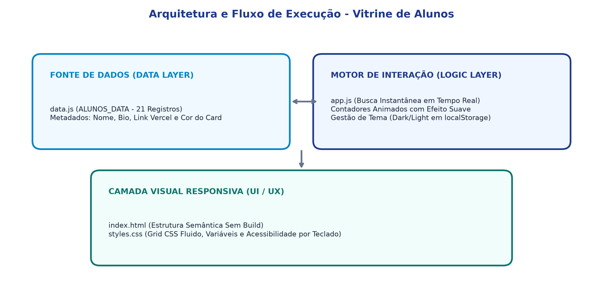
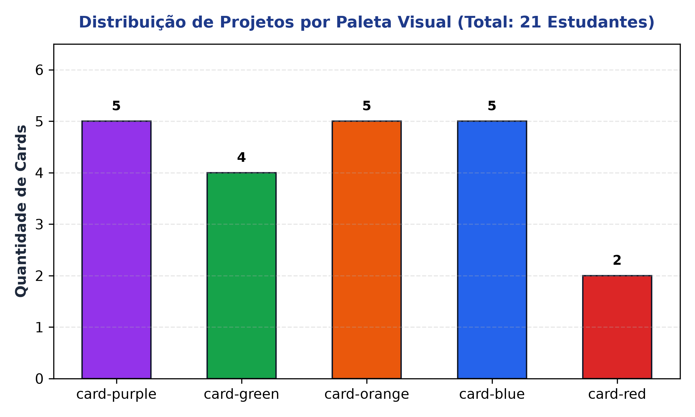

# Vitrine de Alunos - Escola Estadual Monsenhor Bicudo

[](https://developer.mozilla.org/pt-BR/docs/Web/HTML)
[](https://developer.mozilla.org/pt-BR/docs/Web/CSS)
[](https://developer.mozilla.org/pt-BR/docs/Web/JavaScript)
[](https://vercel.com/)
[](#)

Portal estático, responsivo e leve desenvolvido para apresentar e valorizar os projetos tecnológicos de **21 estudantes da Escola Estadual Monsenhor Bicudo** durante a mostra tecnológica de 2026.

---

## 📌 1. Visão Geral e Recursos Implementados

Construído intencionalmente sem frameworks ou dependências externas, o projeto prioriza carregamento instantâneo (< 100ms) e experiência acessível para a comunidade escolar:

- **Busca em Tempo Real:** Filtragem instantânea por nome ou descrição do projeto com limpeza rápida.
- **Contadores Dinâmicos:** Exibição animada da quantidade de alunos e projetos com deploy ativo (85,7% hospedados na Vercel).
- **Tema Claro / Escuro:** Alternância de contraste com persistência da preferência do usuário no `localStorage`.
- **Separação de Dados:** Registros desacoplados em `data.js`, permitindo atualizar alunos sem alterar a estrutura da página.

---

## 📊 2. Evidências Visuais e Arquitetura

| Dimensão | Evidência Gráfica |
| :--- | :--- |
| **Arquitetura e Fluxo** |  |
| **Distribuição de Cards** |  |

---

## ⚙️ 3. Como Executar Localmente

Como a aplicação é 100% estática, basta abrir o arquivo `index.html` em qualquer navegador moderno ou rodar um servidor HTTP local:

```bash
# Na pasta do projeto:
python -m http.server 8000
```
Acesse `http://localhost:8000` no seu navegador.

---

## 📁 4. Estrutura do Repositório

```text
vitrine-alunos/
├── evidencias/                                      # Evidências e diagramas técnicos
│   ├── arquitetura_vitrine_interacao.png
│   ├── distribuicao_cards_paleta.png
│   └── log_validacao_real.txt
├── app.js                                           # Lógica de renderização, busca e tema
├── data.js                                          # Catálogo dos 21 alunos e links
├── favicon.svg                                      # Ícone vetorial da aplicação
├── index.html                                       # Estrutura semântica da página
├── styles.css                                       # Design System e Grid fluido
├── Vitrine_Alunos_Relatorio_Publicacao.docx         # Relatório executivo completo em Word
├── APRESENTACAO.md                                  # Roteiro de pitch e divulgação
└── README.md                                        # Documentação técnica
```

---

## 📄 5. Material de Publicação para Portfólio

O relatório executivo diagramado em Word, contendo a análise arquitetural, métricas de deploy dos alunos e roteiro de publicação para redes profissionais, está disponível em [`Vitrine_Alunos_Relatorio_Publicacao.docx`](file:///d:/projetos/vitrine-alunos/Vitrine_Alunos_Relatorio_Publicacao.docx).
